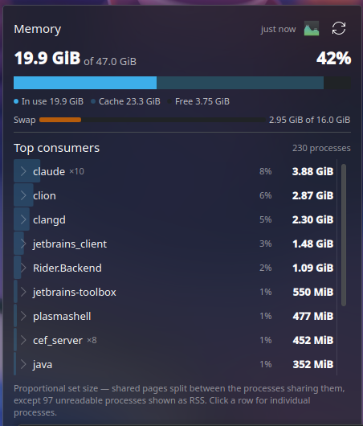

# Memory Usage — KDE Plasma 6 widget

A panel widget that shows RAM usage as a percentage, and gives you a readable
breakdown of what is actually using it when you click.

```
 42%     ← panel: percentage in use
20.9G    ← absolute, below
```



Clicking opens a popup with:

- **Used of total**, with a composition bar split into *in use* /
  *reclaimable cache* / *free* — the three segments are derived from
  `MemTotal`, `MemAvailable` and `MemFree`, so they sum to exactly the total.
- **Swap**, shown only when something is actually swapped out.
- **Top consumers**, grouped by application rather than listed per process —
  nine terminal sessions of the same program appear as one row with a `×9`,
  not nine rows you have to add up yourself.
- Click any row to expand it into the individual processes, with PID, tty and
  uptime — which is what tells otherwise-identical sessions apart.

## Why the numbers differ from `htop`

Per-process figures are **PSS** (proportional set size), not RSS. RSS counts
every shared page in full against every process that maps it, so summing it
across processes badly overstates reality — on the machine this was written
for, RSS overstated one program's 9 sessions by 745 MB, and `dolphin` by 73%.
PSS divides each shared page between the processes sharing it, so the group
totals actually mean something.

Processes whose `smaps_rollup` the kernel won't let a normal user read (root
daemons, all of them small) fall back to RSS, and the popup footnote says how
many. No root, no daemon, no dependencies beyond Python 3 and `/proc`.

## Install

```sh
./install.sh     # symlink package/ into ~/.local/share/plasma/plasmoids, restart plasmashell
```

Then right-click your panel → **Add Widgets** → **Memory Usage**.

To build a distributable package instead:

```sh
./build.sh       # -> dist/mem-usage.plasmoid
kpackagetool6 -t Plasma/Applet -i dist/mem-usage.plasmoid
```

## Cost

The panel reads `/proc/meminfo` only — about 20 ms, polled every 3 s. The full
process scan walks every `/proc/<pid>/smaps_rollup` and costs roughly 400 ms,
so it runs every 5 s **only while the popup is open**, and stops when you close
it.

## Requires

KDE Plasma 6, Python 3, Linux. Developed on Plasma 6.6 / Fedora 43 / Wayland.

## License

MIT
